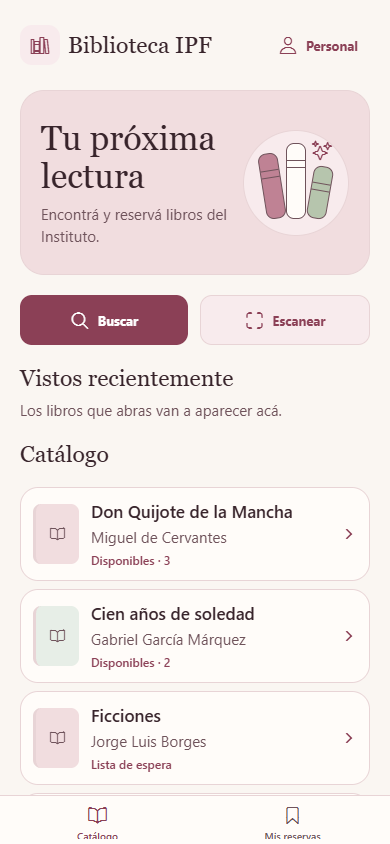

# Biblioteca IPF

Trabajo Práctico 4 de React Native II. La app permite consultar el catálogo de la biblioteca, reservar libros y gestionar préstamos. El personal atiende las listas de espera en orden de llegada.

## Cómo ejecutar

Se usó **Expo SDK 58**, React Native 0.88, TypeScript y Expo Router.

~~~bash
npm ci
npx expo start --lan
~~~

Abrí el QR en Expo Go compatible con SDK 58 desde un teléfono en la misma red. Si la red impide la conexión, podés iniciar Metro con `npx expo start --tunnel`. Para probar el catálogo, la navegación y el ingreso manual de ISBN desde una computadora, ejecutá `npm run web`.

Para entrar al mostrador, tocá **Personal** y usá el usuario `biblioteca` y la clave `ipf2026`. Al ingresar, el modal se cierra. Volvé a tocar **Personal** para abrir el mostrador. Las credenciales, los ejemplares y los préstamos son de demostración. Al reiniciar la app se recuperan los datos iniciales.

## Rutas

~~~text
src/app/
├── _layout.tsx                    Stack raíz, con el contexto y ancla (tabs)
├── (tabs)/
│   ├── _layout.tsx                Tabs de JavaScript (Catálogo y Mis reservas)
│   ├── (catalogo)/
│   │   ├── _layout.tsx            Stack del Catálogo, con ancla index
│   │   ├── index.tsx              /
│   │   └── libro/
│   │       └── [isbn].tsx         /libro/[isbn]
│   └── reservas.tsx               /reservas
├── buscar.tsx                     /buscar?q=
├── escanear.tsx                   /escanear
├── reservar/
│   └── [isbn].tsx                 /reservar/[isbn], modal
├── permisos/
│   └── [recurso].tsx              /permisos/[recurso], modal
├── login.tsx                      /login, modal para personal sin sesión
├── mostrador.tsx                  /mostrador, protegido por sesión
├── reserva.tsx                    /reserva, redirige a /reservas
└── +not-found.tsx                 Rutas inexistentes
~~~

El layout raíz monta el proveedor y delega el Stack a [NavegacionRaiz](src/components/NavegacionRaiz.tsx), donde se declaran los modales y las guardas de sesión.

## Permisos

| Recurso | Módulo | Cuándo se pide | Alternativa |
| --- | --- | --- | --- |
| Cámara | `expo-camera` | Después de tocar **Habilitar cámara** en el escáner y luego **Continuar**. Si el sistema lo bloqueó, la previa abre Ajustes. | Ingresar el ISBN a mano con o sin guiones. |
| Notificaciones locales | `expo-notifications` | Solo al activar **Recordarme** en un préstamo y luego **Continuar** si hace falta. En Android se prepara el canal `prestamos` antes de pedirlo. | La fecha de devolución y los avisos de entrega se ven en **Mis reservas**. |

Este es el bloque de plugins de [app.json](app.json), con comentarios explicativos.

~~~jsonc
"plugins": [
  "expo-router", // Genera la navegación y los enlaces desde las rutas.
  [
    "expo-camera",
    {
      "cameraPermission": "Usamos tu cámara para leer el ISBN de un libro y abrir su ficha.",
      "microphonePermission": false, // Omite el texto de propósito de micrófono en iOS.
      "recordAudioAndroid": false // La cámara no graba audio.
    }
  ],
  [
    "expo-notifications",
    {
      "enableRemoteNotifications": false, // La app programa notificaciones locales.
      "enableBackgroundRemoteNotifications": false
    }
  ]
]
~~~

La pantalla previa de notificaciones explica el uso con la frase «Usamos tus notificaciones para recordarte cuándo devolver un libro». Android e iOS presentan el texto estándar del sistema para este permiso. El texto nativo personalizable de cámara se declara en el plugin para iOS. [Permisos de Expo](https://docs.expo.dev/guides/permissions/) · [Expo Notifications](https://docs.expo.dev/versions/v58.0.0/sdk/notifications/)

`blockedPermissions` excluye `RECORD_AUDIO` y los permisos de lectura de fotos, videos y almacenamiento, además de escritura en almacenamiento externo y superposición de ventanas. El escáner usa la imagen en vivo para leer el código. La app no accede a la galería ni crea archivos de medios, y sus avisos se muestran dentro de la app o como notificaciones del sistema.

## Deep links de prueba

En Expo Go reemplazá `IP:8081` con la dirección que muestra Metro. El esquema `bibliotecaipf` corresponde a una build propia.

| Build propia | Expo Go |
| --- | --- |
| `bibliotecaipf://libro/9780142437230` | `exp://IP:8081/--/libro/9780142437230` |
| `bibliotecaipf://libro/123` | `exp://IP:8081/--/libro/123` |
| `bibliotecaipf://buscar?q=borges` | `exp://IP:8081/--/buscar?q=borges` |
| `bibliotecaipf://mostrador` | `exp://IP:8081/--/mostrador` |
| `bibliotecaipf://reserva` | `exp://IP:8081/--/reserva` |
| `bibliotecaipf://escanear` | `exp://IP:8081/--/escanear` |
| `bibliotecaipf://ruta-inexistente` | `exp://IP:8081/--/ruta-inexistente` |

Dos ediciones con ISBN real para probar el lector son **Don Quijote de la Mancha** (`9780142437230`, Penguin Classics) y **Cien años de soledad** (`9780307474728`, Vintage Español). Buscá esos números exactos en la contratapa de la edición que uses. El campo año muestra la primera publicación de la obra. [Edición de Don Quijote](https://www.penguinrandomhouseretail.com/book/?isbn=9780142437230) · [Edición de Cien años de soledad](https://penguinrandomhouselibrary.com/book/?isbn=9780307474728)

## Verificación y capturas

~~~text
> npx expo lint
expo lint exit: 0

> npx tsc --noEmit
tsc --noEmit exit: 0
~~~

Expo también generó los bundles de JavaScript para Android e iOS con `npx expo export --platform android --platform ios`.

### Chrome

Las [capturas web](evidencias/web) corresponden a Chrome con vista de 390 × 844. En el catálogo se controló el azar de la API simulada durante la prueba para reproducir la falla y el reintento.

| Flujo | Capturas |
| --- | --- |
| Catálogo | [Cargando](evidencias/web/01-catalogo-cargando.png) · [Error](evidencias/web/02-catalogo-error.png) · [Con datos](evidencias/web/03-catalogo.png) |
| Búsqueda | [Resultados de «borges»](evidencias/web/04-buscador.png) |
| Reservas | [Confirmar préstamo](evidencias/web/05-confirmar-prestamo.png) · [Préstamo activo](evidencias/web/06-prestamo-activo.png) · [Confirmar espera](evidencias/web/07-confirmar-espera.png) · [Posición](evidencias/web/08-reserva-en-espera.png) |
| Mostrador | [Antes de entregar](evidencias/web/09-mostrador-antes.png) · [Después de entregar](evidencias/web/10-mostrador-despues.png) · [Aviso en la app](evidencias/web/11-aviso-de-entrega.png) |
| ISBN y rutas | [ISBN manual desconocido](evidencias/web/12-isbn-manual-inexistente.png) · [Detalle inexistente](evidencias/web/13-detalle-inexistente.png) · [404](evidencias/web/14-no-encontrada.png) |

### Android con Expo Go

| Captura | Qué muestra |
| --- | --- |
| [Escáner con permiso de cámara concedido](evidencias/android/01-escaner-camara-concedida.jpeg) | El visor activo apunta al código EAN-13 de prueba de *Don Quijote de la Mancha*. |
| [Ficha del ISBN escaneado](evidencias/android/02-ficha-isbn-escaneado.jpeg) | La ficha de *Don Quijote de la Mancha* muestra el ISBN `9780142437230` y tres ejemplares disponibles. |
| [Recordatorio de devolución sobre Mis reservas](evidencias/android/03-recordatorio-banner-en-mis-reservas.jpeg) | El banner de Android avisa que hay que devolver *Frankenstein*. La pantalla muestra las notificaciones habilitadas y **Recordarme** activo. |
| [Recordatorios en el panel de Android](evidencias/android/04-recordatorios-panel-de-android.jpeg) | El panel reúne dos avisos recibidos, uno para *Frankenstein* y otro para *Jane Eyre*. |
| [Escáner con permiso de cámara preguntable](evidencias/android/05-escaner-camara-preguntable.jpeg) | El escáner ofrece **Habilitar cámara** y mantiene disponible el ingreso manual de ISBN. |
| [Pantalla previa al permiso de cámara](evidencias/android/06-pantalla-previa-permiso-camara.jpeg) | Biblioteca IPF explica para qué usa la cámara y ofrece **Continuar**. |
| [Diálogo de Android para el permiso de cámara](evidencias/android/07-dialogo-android-permiso-camara.jpeg) | Después de **Continuar**, Android muestra el diálogo de Expo Go con opciones para permitir o denegar el acceso. |

Quedan por documentar con capturas los estados de cámara **cargando** y **bloqueado**. El [análisis de permisos](RESPUESTAS.md#d1-recorrido-completo-de-la-cámara) describe qué muestra cada estado.

Para verificar la cancelación en el teléfono, activá **Recordarme** y esperá el aviso de prueba programado a los 15 segundos. Después activalo en otro préstamo y apagalo o devolvé ese libro antes de los 15 segundos. El aviso de ese préstamo debe quedar cancelado.

Si el diálogo de notificaciones falla en Expo Go, tocá **Abrir Ajustes**, habilitá las notificaciones de **Expo Go** y volvé a Biblioteca IPF. La app vuelve a consultar el permiso y programa el recordatorio si lo habilitaste.

Si Expo Go en Android falla al crear el canal `prestamos`, la demostración usa el canal predeterminado de Expo Go. En ese caso, dejá la app abierta durante los 15 segundos. El aviso que se publica al terminar la espera es una notificación local de Android.

## Análisis

[Respuestas de las partes B a E](RESPUESTAS.md).
